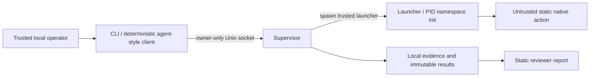
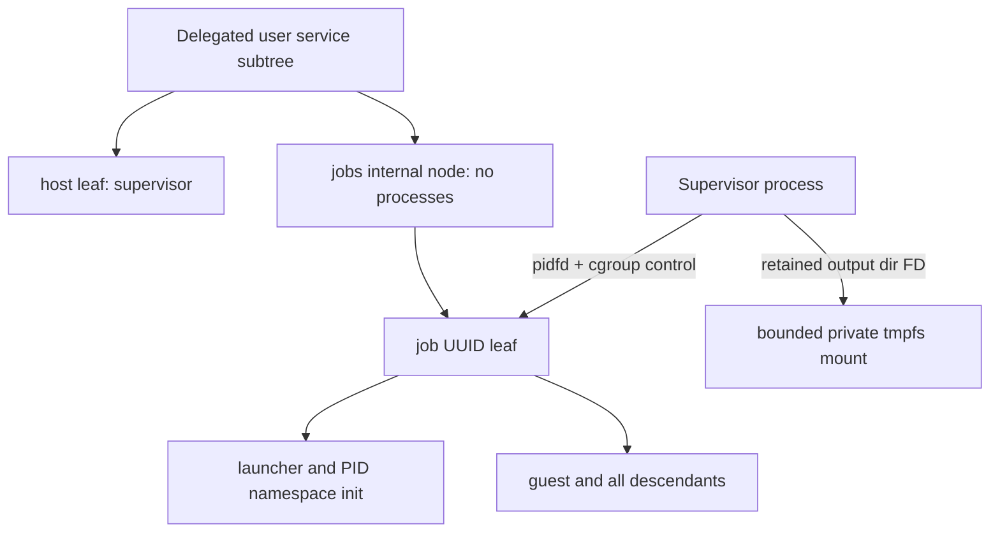
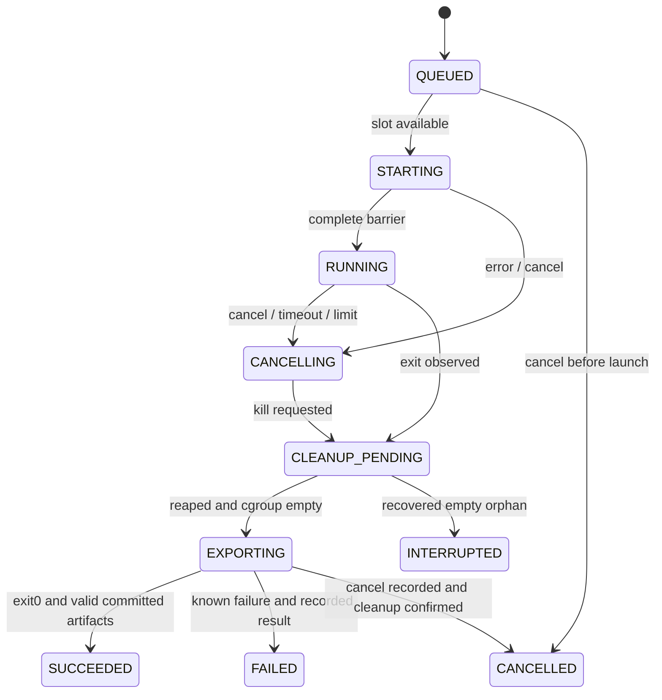
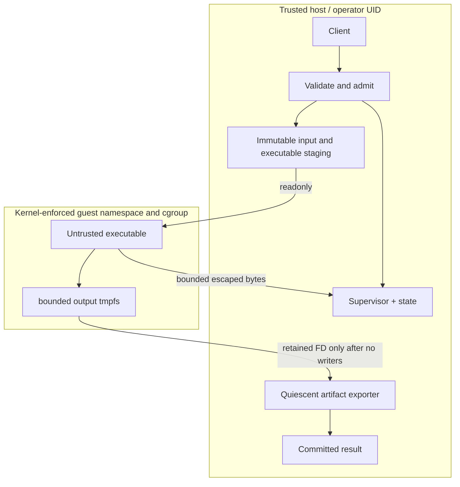
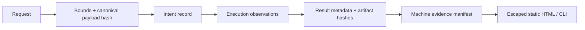
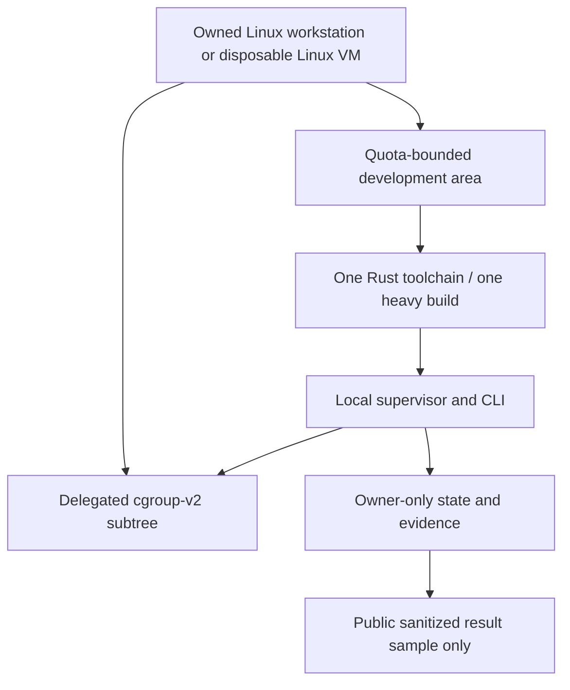

# Architecture

Status: specified design, not a tested containment claim. The public code must implement this contract before the product is marked complete.

## Boundaries and state ownership
One Rust supervisor owns admission, request identity, job transitions, state files, cgroups and result publication. Its asynchronous event loop may use worker threads only for bounded blocking I/O. It launches a new executable, hearthrun-launcher, via a normal exec/spawn boundary. All namespace and child setup occurs inside that fresh, initially single-threaded process, not arbitrary Rust code after fork from a multithreaded supervisor. Launcher code uses a small audited unsafe syscall boundary. Guest execution is a different trust zone and never receives supervisor descriptors.

The supervisor listens on an AF_UNIX stream socket owned0600; verifies SO_PEERCRED against the configured UID; one request per connection with u32 big-endian framing, maximum65536 bytes. JSON is strict, versioned and bounded. There is no HTTP/TLS remote endpoint. Read clients cannot bypass the trusted-local-operator assumption by masquerading as multi-tenant security.

State lives under owner-only HEARTHRUN_STATE, never inside a guest mount. Canonical request intent is written temp->file fsync->rename->directory fsync before admission acknowledgement. A single event owner serializes lifecycle transitions. Updates are bounded JSON records with sequence and version. No SQLite/database dependency. Output publication uses separate temporary and final directories; a final result.json is the publication point. Persistence errors stop further admission until inspected/restarted. State lock uses flock on an owner-created file; do not unlink/recreate a held lock.

## Context


## Runtime / cgroup hierarchy

The delegated root has no process when distributing controllers. Put the supervisor in a separate host leaf before enabling cpu,memory,pids for jobs. Guest never sees writable cgroup files. Rootless mapping is a single host UID/GID: parent writes setgroups=deny, uid_map and gid_map as appropriate, with a bounded synchronization handshake. An existing authorized systemd delegation may be used; never globally disable userns restrictions to make a test pass. No setuid helper is distributed.

## Launch protocol and critical ordering
1. Validate request and profile; enforce queue and storage reservation; persist intent. Resolve operator-installed executable once under protected profile storage, copy verified bytes to an immutable per-job staging file, verify SHA-256 on that exact opened inode and retain its FD. Staged files are never mutable by untrusted code. Reject dynamic ELF interpreters and non-x86-64 initially. Canonical input names are logical paths, not host mount paths; copy regular bounded input into protected staging through descriptors.
2. Create per-job cgroup, apply memory.max=268435456, memory.swap.max=0, memory.oom.group=1, pids.max=32, cpu.max='100000 100000'. Generate a random per-launch nonce and socketpair. Spawn trusted launcher blocked on this socket. Acquire pidfd without reaping child; place launcher in job cgroup before its first fork. The trusted launcher may run setup instructions before placement; no untrusted executable can.
3. Launcher sets parent-death handling and verifies expected parent, establishes namespaces, private mount propagation and private root, creates bounded output tmpfs, mounts immutable executable and input readonly, no host proc/dev/cgroup. It forks a PID-namespace init only from this single-threaded process; init reaps all descendants. Parent/child death chain must be tested, not assumed. Close the inherited root/control descriptors in the eventual guest.
4. Open /out as O_PATH|O_DIRECTORY in the trusted launcher and pass that FD to supervisor using SCM_RIGHTS plus nonce and structured setup result. Receiver enforces exact ancillary descriptor count, MSG_CTRUNC rejection, CLOEXEC and directory fstat. The FD retains the mount for later export even after all job processes die. Do not accept a guest-selected FD.
5. Drop supplementary groups/capabilities, use no_new_privs, Landlock ABI>=3 handling all applicable filesystem rights (including REFER/TRUNCATE), restrict execution to approved /bin/task, readonly /in and writable /out. No device creation or network. Install architecture-checked seccomp allowlist with explicit x32 refusal. Setup-only calls (mount/unshare/setns) are unavailable to guest. Any new kernel right/syscall is denied until reviewed; unsupported ABI is fail-closed, not best effort.
6. Supervisor releases EXEC permission only after verified setup acknowledgement, cgroup membership/limits and retained output FD. Launcher executes the pre-staged /bin/task in private readonly root with fixed PATH/LANG/TZ and minimal argv. It does not execute a mutable host pathname. Guest inherits only stdio. Executable identity is recorded with policy/config/kernel fingerprints.
7. Monitor leader/pidfd, event pipes, output bounds, wall timeout and cgroup events. On any cancellation/failure kill via cgroup.kill. Reap trusted immediate child. Wait for populated=0. Uninterruptible tasks remain cleanup_pending; no forced success after a timeout.
8. With no writers remaining, enumerate via retained /out directory FD. Only relative UTF-8 logical names, no '..', NUL or absolute paths. Use openat2 with RESOLVE_BENEATH|RESOLVE_NO_SYMLINKS|RESOLVE_NO_MAGICLINKS|RESOLVE_NO_XDEV; allow traversal within this tmpfs but no submount. Reject nonregular files, nlink!=1, duplicate normalized paths, excessive depth/count/size. Copy exact checked open FDs into owner-only temporary result files; hash bytes, fsync files and directory, atomic publish and fsync parent. Close mount FD and remove job cgroup only after emptiness confirmed. Landlock is defense in depth, not a substitute for safe host export.

```mermaid
sequenceDiagram
 participant C as Client
 participant S as Supervisor
 participant L as Trusted launcher
 participant G as Guest
 C->>S: bounded request + retry ID
 S->>S: persist intent, limits, launch gate
 S->>L: spawn blocked; attach cgroup
 L->>L: namespaces, mounts, policy, fd closure
 L->>S: ready + output FD + nonce
 S->>L: release EXEC gate
 L->>G: exec approved staged binary
 S->>S: deadline/cancel -> cgroup.kill
 G-->>S: output/exit observations
 S->>S: reap + cgroup empty -> export -> commit
 S-->>C: explicit terminal result
```

## Concurrency, retries and recovery
Single-owner state machine removes lock-order ambiguity; blocking copying/hashing uses a bounded pool and explicit reservations. Four running slots, sixteen queue positions; FIFO does not imply equal CPU time. Every job owns exactly one slot until cleanup is proven. No retries of execution or uncertain external effects. Same request ID with identical canonical payload returns the recorded ID/status; altered payload is CONFLICT. Normalize absent optional fields before hashing, and reject duplicate JSON keys before normalization.

Startup checks ownership/permissions/state version, acquires flock, probes kernel features, reads the bounded request index and enumerates only this instance's named cgroups under its already-open delegated jobs parent. Match persisted instance/job UUID and metadata; never kill arbitrary processes by stale PID. Kill recorded orphan job groups, require empty, and mark interrupted. Ambiguous/corrupt ownership refuses cleanup of foreign state and keeps admission closed. Persisted states are not evidence that execution succeeded. Graceful shutdown stops admission, cancels queued/active jobs, drains bounded streams and records pending cleanup before exit. Parent-death handling limits orphan duration but does not eliminate the need for recovery.

## State machine

UNKNOWN is a result/diagnostic condition when persistence prevents establishing a durable terminal outcome; it is never substituted with success. A queued cancellation is terminal without a cgroup because no launch happened. All terminal transitions require proof appropriate to the reached launch stage.

## Trust and data flow




## Deployment


## Component removal tests
|Component|Requirement|Simpler alternative|Decision and property lost if removed|
|---|---|---|---|
|Exec-separated launcher|SEC-002|Do setup in threaded parent after fork|Keep: auditable single-threaded setup and controlled inherited state|
|cgroup per job|REL-002/005|Process-group kill + rlimits|Keep: descendant accounting/kill despite setsid and aggregate limits|
|pidfd|REL-001|Store numeric PID|Keep: stable immediate-child identity; does not replace cgroup kill|
|Namespaces/private root|SEC-003|Path checks only|Keep: guest-visible filesystem/network/PID separation|
|Landlock + seccomp|SEC-002/003|Namespaces alone|Keep: filesystem and syscall restriction in depth; neither prevents kernel exploits|
|Output dir FD / quiescence|SEC-004|Reopen guest path while running|Keep: bind export to actual private mount without live writer races|
|Small durable request index|FR-005/REL-003|Memory-only map|Keep: retry identity and explicit restart outcomes; not a workflow engine|
|Static report|UX-001|CLI only|Optional presentation layer; core remains fully usable without it|
|Database / broker / Kubernetes / model|none|None|Omit: no essential core property lost|

## Observability and compatibility
Structured logs: event, job ID, monotonic duration, state, typed reason, policy SHA and environment ID; no raw environment dump, tokens or host input paths. Counters: admitted/rejected/active/queued/cleanup_pending, bytes retained/discarded, resource-limit events. Metrics are a local JSON command, not an unauthenticated network service. Trace IDs are job UUIDs; OpenTelemetry collector is unnecessary. Protocol and state v1 have no automatic migration; unsupported versions fail closed, with explicit offline migration tool required in a future ADR.
