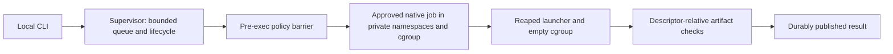

# HearthRun

HearthRun is an experimental local Linux runtime for operator-approved static executables. It stages bounded input, starts each job behind a kernel policy gate, and waits for cleanup before publishing checked artifacts.

**Status.** This is an experimental source preview. The Rust workspace builds, and finite native integration runs have passed on one compatible Linux x86-64 WSL2 host. They exercised the real Unix socket, staged transformation, detached cancellation, wall expiry, crash recovery, and FIFO admission at four running and sixteen queued jobs. The full locked acceptance, fault, and benchmark campaigns remain open.

[Architecture](ARCHITECTURE.md) | [Acceptance](ACCEPTANCE_SPEC.md) | [Security](SECURITY.md) | [Evidence](VERIFICATION_REPORT.md) | [API](API.md)

## Why this exists

An exit code describes one process. HearthRun separately observes reaping, cgroup emptiness, checked artifact bytes and durable publication.



## Try what is implemented

Portable checks require Python 3.11+ and Make. Rust checks use the pinned toolchain. Native execution requires a compatible Linux x86-64 host and an operator-owned cgroup v2 jobs parent. [Host setup and teardown](OPERATIONS.md)

```bash
make tooling-test
make demo-offline
make doctor
```

The offline report at `.work/report.html` uses a fixture marked `NOT RUN`. `doctor` probes host operations and reports missing capabilities by name.

Rust source commands, after installing the pinned toolchain in a bounded development area:

```bash
make build
make fmt
make lint
make typecheck
make unit
```

`make integration-run` runs the finite native tests with prebuilt binaries and the prerequisites in the operations guide. [Verification scope and evidence](VERIFICATION_REPORT.md)

`make demo-run` generates the recorded demo report. [Demo walkthrough](docs/demo/README.md)

## Intended core

| Concern | Design contract |
|---|---|
| Admission | Four running jobs and sixteen queued, bounded FIFO |
| Authority | Same-UID owner-only Unix socket; operator-approved static x86-64 executables |
| Boundary | Namespaces, delegated cgroupv2, Landlock and architecture-checked seccomp |
| Completion | Reaped launcher, empty cgroup and recorded publication outcome |
| Artifacts | No export before quiescence; descriptor-relative checked regular files |
| Recovery | Explicit interrupted/unknown state; no automatic replay of uncertain work |

The 24 locked criteria define the release gate. [Limitations](LIMITATIONS.md)

## Repository map

`crates/` contains the domain, launcher, supervisor and CLI. `tools/doctor.c` probes required kernel operations. `scripts/` captures evidence and renders escaped reports. `tests/` holds portable and native checks, and `spec/` holds the locked acceptance contract.

Read [CONTRIBUTING.md](CONTRIBUTING.md), [VERIFICATION.md](VERIFICATION.md) and [OPERATIONS.md](OPERATIONS.md) before changing execution behavior. Original source and documentation are MIT-licensed. Third-party components retain their own licenses.
